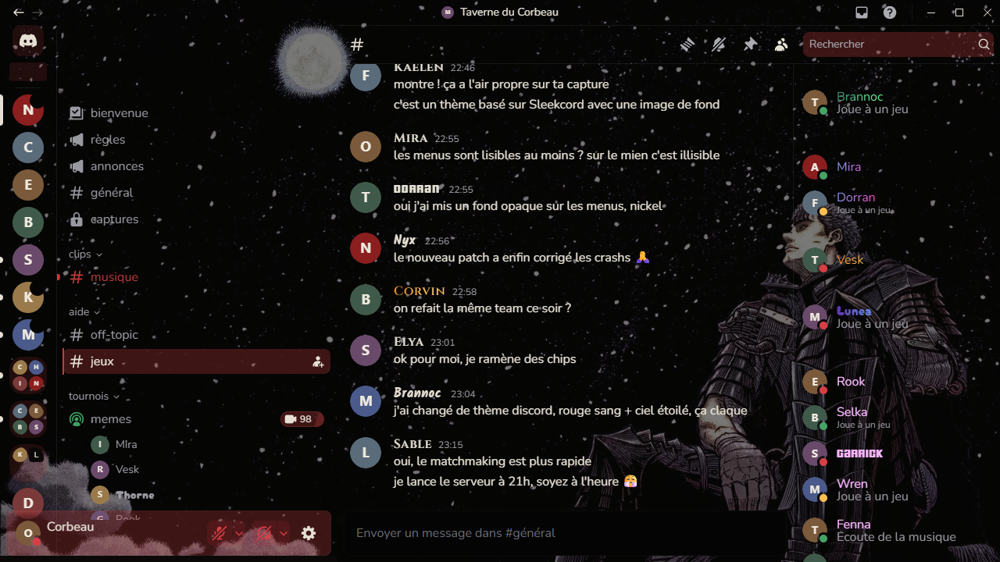

# Berserk — BetterDiscord Theme

A dark, blood-red BetterDiscord theme built on top of [Sleekcord](https://github.com/TNT4ME/SleekCord) by TNT4ME.

> **Preview note:** the screenshot uses **fictional content only** — the server, channels, usernames, avatars and messages shown are fake and were generated for this preview.

## Features

- **Palette** — warm ink-black backgrounds, blood-red accent, moonlight-grey links, parchment-white text
- **Engraved headings** — channel and server titles use the Cinzel typeface
- **Full-screen background image** — fixed, `cover`-sized, anchored to the right, 45% opacity by default
- **Background fix** — makes Discord's opaque `.bg_*` layer and server bar transparent, so the background image no longer disappears once Discord has finished loading (prefix selectors, resilient to Discord's class-name changes)
- **Readable menus** — context menus, popouts and autocomplete get an opaque dark background with a blood-red border, so they stay legible over the image

## Installation

1. Download `Berserk.theme.css`
2. Put it in your BetterDiscord themes folder:
   - Windows: `%APPDATA%\BetterDiscord\themes\`
   - macOS: `~/Library/Application Support/BetterDiscord/themes/`
   - Linux: `~/.config/BetterDiscord/themes/`
3. In Discord: **Settings → BetterDiscord → Themes → enable _Berserk_**
4. If you also have **Sleekcord** installed separately, disable it — Berserk already imports it.

## Customization

Edit the variables in the `:root` block at the top of the file:

| Variable | Description | Default |
|---|---|---|
| `--SL-accentCol` | Accent color | `oklch(0.55 0.17 25)` (blood red) |
| `--SL-backgroundImg` | Background image — `url(...)` with a direct image link or a data URI | embedded image |
| `--SL-imgOpacity` | Background image visibility | `45%` |
| `--SL-imgBlur` | Background image blur | `0px` |
| `--SL-txtCol` | Main text color | `#e6e0d4` |
| `--SL-linkCol` | Link color | `oklch(0.80 0.03 270)` |

**Using your own image:** replace the value of `--SL-backgroundImg` with `url('https://your-direct-image-link.jpg')`. Dark images work best; raise or lower `--SL-imgOpacity` to taste.

> The theme file currently embeds the background image as base64, which makes it large. Edit it with a regular text editor rather than BetterDiscord's built-in editor.

## Credits

- Base theme: [Sleekcord](https://github.com/TNT4ME/SleekCord) by TNT4ME — see its license
- Fonts: [Nunito](https://fonts.google.com/specimen/Nunito), [Cinzel](https://fonts.google.com/specimen/Cinzel), [JetBrains Mono](https://fonts.google.com/specimen/JetBrains+Mono) via Google Fonts

## Disclaimer

The background image included in this theme and shown in the preview is fan artwork based on ***Berserk*** by **Kentaro Miura** (published by **Hakusensha**). **I do not own this image** and claim no rights over it; all rights belong to their respective owners. It is included for personal, non-commercial use only.

**The repository author is not responsible for how the image is used.** If you use, share or redistribute this theme, it is your own responsibility to make sure you have the right to use the image — or replace it with your own via `--SL-backgroundImg`.

If you are a rights holder and want the image removed, please open an issue and it will be taken down.

This project is not affiliated with Discord, BetterDiscord, Kentaro Miura, Hakusensha, or the *Berserk* franchise.
